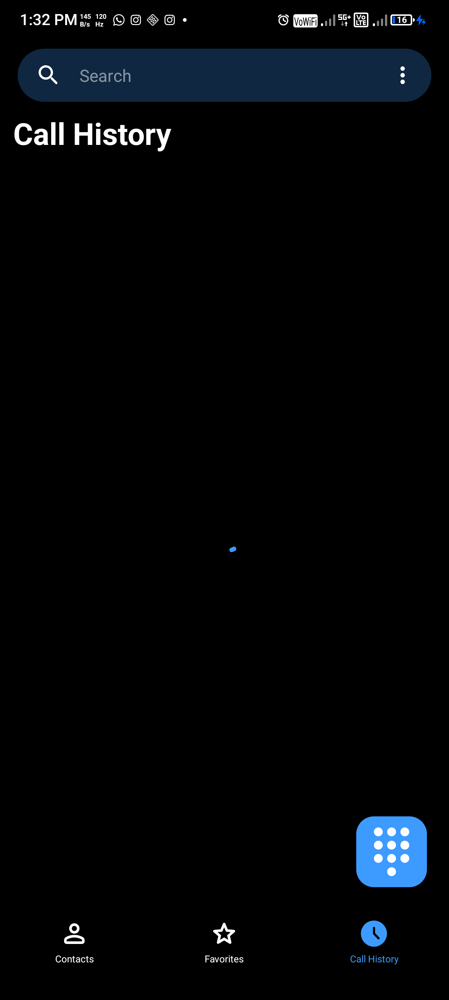
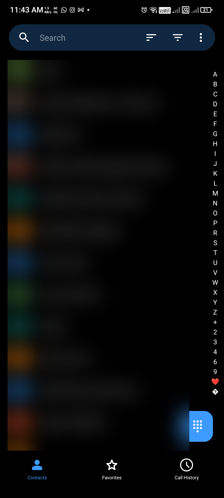
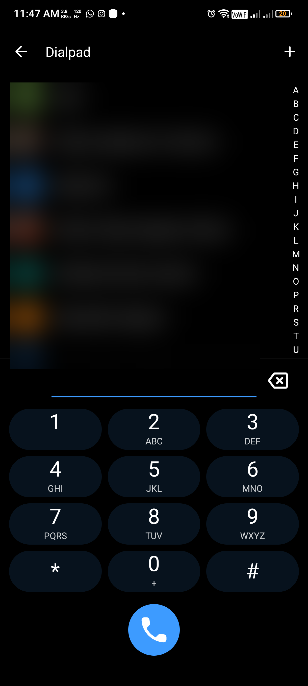

# HyperDial

A phone app with a HyperOS-inspired look, built for the Lava Agni 4 (works on
any Android 8.0+ phone). It handles dialing, recent calls, contacts and the
in-call screen, can be set as the default Phone app, and can automatically
record your calls and back them up to your own Google Drive.

HyperDial is based on [Fossify Phone](https://github.com/FossifyOrg/Phone).
All call handling is Fossify Phone's; HyperDial changes how it looks and adds
call recording. It is not affiliated with Fossify or Xiaomi.

## Screenshots

| Call History | Contacts | Dialpad |
|:---:|:---:|:---:|
|  |  |  |

> Contact names and photos are blurred for privacy.

## Features

- **HyperOS-style interface** — large collapsing screen title, bottom tabs, and
  an accent dial button, restyled over Fossify Phone's dialer.
- **Automatic call recording** — records each call to a local `.m4a` (AAC) with
  no announcement tone. Turn it on in **Settings → Call recording → Record calls
  automatically**.
- **Google Drive backup** — recordings upload to a `HyperDial Recordings` folder
  in your own Drive, **only on Wi-Fi**, using the `drive.file` scope (the app
  only ever sees files it created). Sign in from the same settings screen.
- **Recordings screen** — play or delete recordings and see their upload status.

### A note on call recording

Since Android 10, Google blocks ordinary apps from capturing call audio: the
system **mutes the microphone for third-party apps during a call**. On phones
that enforce this, HyperDial still creates and lists the recording, but the
audio comes out silent. Reliable both-sides recording on a locked (non-root)
device needs a privileged audio source reached through
[Shizuku](https://shizuku.rikka.app/) — that path is planned and the recorder
is built so it drops in without changing the rest of the app. Whether a given
device permits it has to be checked on that device.

## Build

Needs JDK 17+ and the Android SDK (platform 36).

```sh
./gradlew assembleFossDebug
```

The APK is written to `app/build/outputs/apk/foss/debug/`.

To place calls and enumerate SIMs, HyperDial must be set as the default phone
app (Settings → Apps → Default apps → Phone app), and granted the microphone,
phone and call-log permissions.

### Google Drive setup (optional, for upload)

Drive sign-in needs a one-time Google Cloud OAuth client:

1. Create a Google Cloud project and enable the **Google Drive API**.
2. OAuth consent screen: **External**, publishing status **Testing**; add your
   own Google account as a test user.
3. Create an **Android OAuth client** with this app's package name and your
   signing certificate's SHA-1. No `google-services.json` is required; the app
   requests only the `drive.file` scope.

## License

GPL-3.0, the same as Fossify Phone. See [LICENSE](LICENSE).
